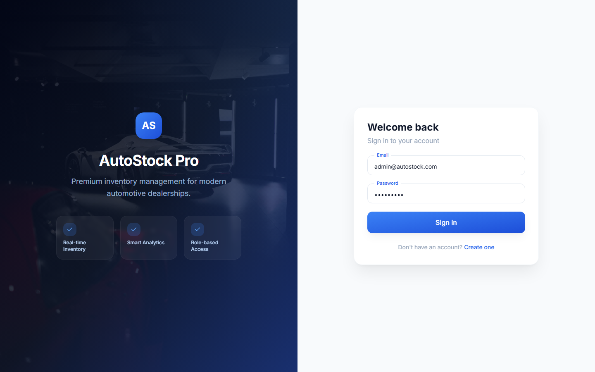
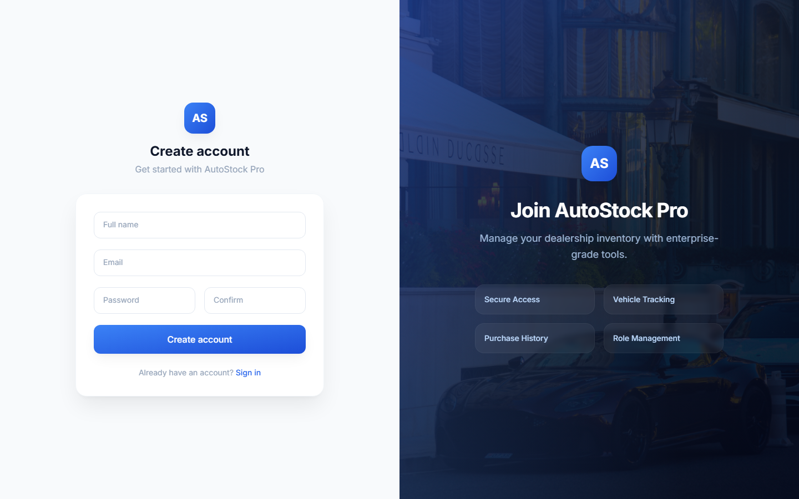
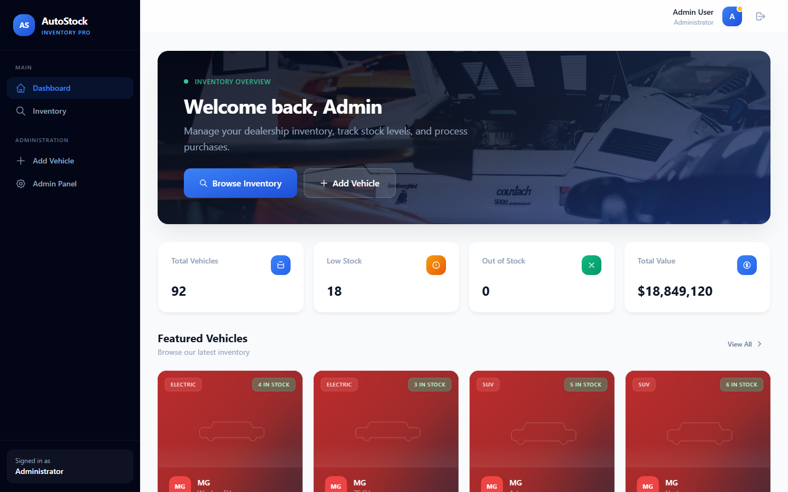
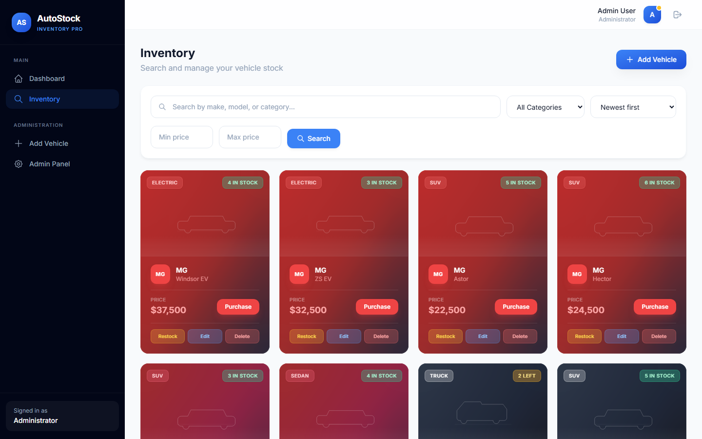
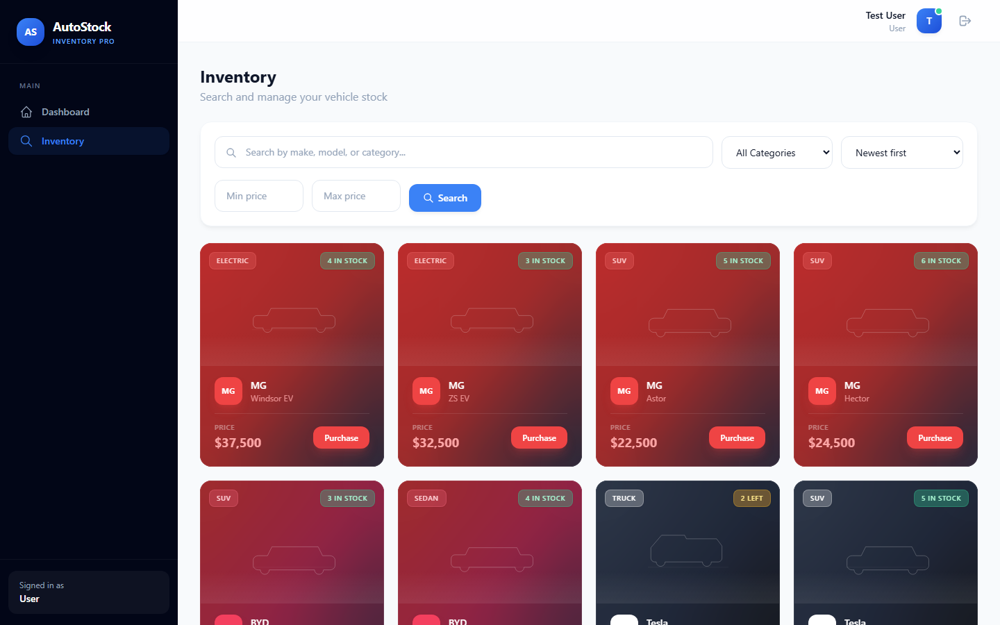
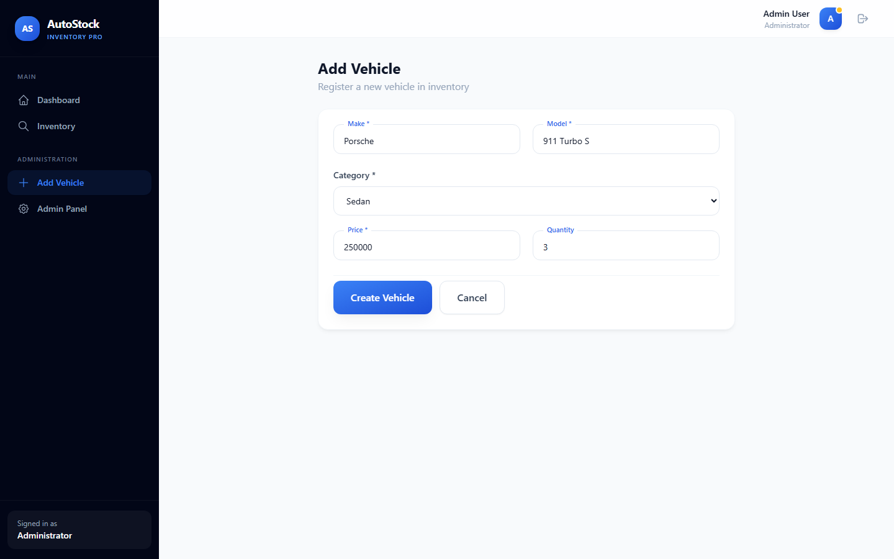
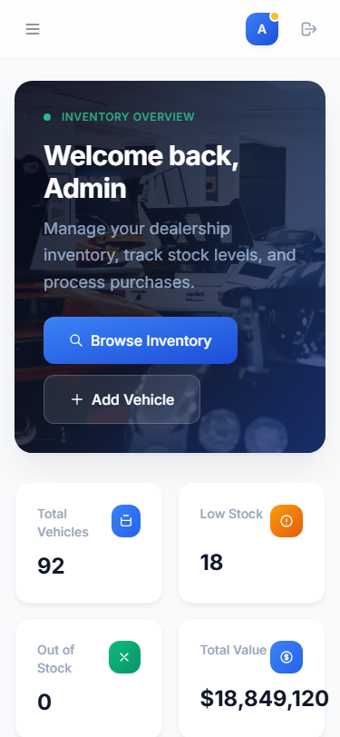

# AutoStock-Pro — Car Dealership Inventory System

A full-stack web application for managing car dealership inventory. Built with Node.js/Express, Supabase PostgreSQL, and React, it provides role-based inventory management with JWT authentication, vehicle search/filtering, purchase tracking, and admin controls.

---

## Table of Contents

- [Project Overview](#project-overview)
- [Features](#features)
- [Technology Stack](#technology-stack)
- [Project Structure](#project-structure)
- [Installation Guide](#installation-guide)
- [API Documentation](#api-documentation)
- [Database Schema](#database-schema)
- [Authentication Flow](#authentication-flow)
- [Testing](#testing)
- [Screenshots](#screenshots)
- [My AI Usage](#my-ai-usage)
- [Deployment](#deployment)
- [Future Improvements](#future-improvements)

---

## Project Overview

AutoStock-Pro is a car dealership inventory management system that allows dealership staff to track vehicle stock, process purchases, and manage inventory data. The application features two user roles:

- **Admin** — Full CRUD on vehicles, restock capability, access to admin dashboard with inventory statistics
- **User** — Browse vehicles, search/filter inventory, record purchases

The backend follows the MVC + Repository pattern with middleware-based authentication, authorization, validation, and error handling. The frontend is a single-page application built with React, React Router, and TailwindCSS.

---

## Features

- **User Registration** — New users can create an account with name, email, and password
- **User Login** — Registered users authenticate with email and password to receive JWT tokens
- **JWT Authentication** — Access tokens (15 min) + refresh tokens (7 days) with secure rotation
- **Vehicle Inventory** — Browse all vehicles with paginated listing (20 per page)
- **Vehicle Search** — Search by make, model, category, and price range with sorting options
- **Purchase Vehicle** — One-click purchase that decrements quantity and records the transaction
- **Admin Vehicle Management** — Add, edit, delete vehicles; restock inventory (admin-only)
- **Responsive UI** — Mobile-friendly design with TailwindCSS (breakpoints at 640px, 768px, 1024px)
- **Role-Based Access Control** — Admin-only routes guarded by backend middleware and frontend protected routes

---

## Technology Stack

### Frontend

| Library | Version | Purpose |
|---------|---------|---------|
| React | 18.3 | UI library |
| Vite | 5.4 | Build tool and dev server |
| TailwindCSS | 3.4 | Utility-first CSS framework |
| React Router | 6.26 | Client-side routing |
| Axios | 1.7 | HTTP client with JWT interceptors |

### Backend

| Library | Version | Purpose |
|---------|---------|---------|
| Node.js | 18+ | Runtime |
| Express | 4.21 | Web framework |
| JWT (jsonwebtoken) | 9.0 | Access and refresh token generation/verification |
| bcrypt | 5.1 | Password hashing (12 salt rounds) |
| Joi | 17.13 | Request validation schemas |
| Supabase JS SDK | 2.45 | Database client (service-role, bypasses RLS) |
| Helmet | 7.1 | HTTP security headers |
| Compression | 1.7 | Gzip compression |
| Morgan | 1.10 | HTTP request logging |

### Database

| Technology | Purpose |
|------------|---------|
| Supabase PostgreSQL | Managed PostgreSQL with auto-scaling |
| Supabase JS SDK | Database queries with chainable filters |

### Testing

| Library | Purpose |
|---------|---------|
| Jest 30 | Test runner and assertions |
| Supertest 7 | HTTP integration testing |

---

## Project Structure

```
autostock-pro/
├── backend/
│   ├── src/
│   │   ├── config/              # Supabase client, env loader
│   │   │   ├── database.js
│   │   │   └── env.js
│   │   ├── middleware/           # Express middleware
│   │   │   ├── authenticate.js   # JWT verification
│   │   │   ├── authorize.js      # Role check
│   │   │   ├── errorHandler.js   # Global error handler
│   │   │   └── validate.js       # Joi validation runner
│   │   ├── migrations/           # SQL migration files
│   │   │   ├── 001_initial.sql   # Users + Vehicles tables
│   │   │   └── 002_purchases.sql # Purchases table
│   │   ├── modules/
│   │   │   ├── auth/             # Auth module (MVC + Repository)
│   │   │   │   ├── auth.controller.js
│   │   │   │   ├── auth.routes.js
│   │   │   │   ├── auth.service.js
│   │   │   │   ├── auth.repository.js
│   │   │   │   ├── auth.validation.js
│   │   │   │   └── __tests__/
│   │   │   │       ├── auth.routes.test.js
│   │   │   │       ├── auth.service.test.js
│   │   │   │       └── auth.validation.test.js
│   │   │   └── vehicles/         # Vehicle + Purchase module
│   │   │       ├── vehicle.controller.js
│   │   │       ├── vehicle.routes.js
│   │   │       ├── vehicle.service.js
│   │   │       ├── vehicle.repository.js
│   │   │       ├── vehicle.validation.js
│   │   │       ├── purchase.repository.js
│   │   │       └── __tests__/
│   │   │           ├── vehicle.routes.test.js
│   │   │           ├── vehicle.service.test.js
│   │   │           ├── vehicle.validation.test.js
│   │   │           └── error-handling.test.js
│   │   ├── routes/
│   │   │   └── v1.js             # Route aggregator (/api/v1)
│   │   ├── shared/
│   │   │   ├── constants/        # Roles, status codes
│   │   │   ├── errors/           # AppError class
│   │   │   └── utils/            # asyncHandler, pagination, response helpers
│   │   └── server.js
│   ├── scripts/
│   │   ├── migrate.js            # Run SQL migrations
│   │   └── seed.js               # Seed 92 vehicles + 2 users
│   ├── package.json
│   └── .env
├── frontend/
│   ├── src/
│   │   ├── api/
│   │   │   └── axios.js          # Axios instance + refresh interceptor
│   │   ├── components/
│   │   │   ├── ui/               # Reusable UI primitives
│   │   │   │   ├── Badge.jsx
│   │   │   │   ├── Button.jsx
│   │   │   │   ├── Card.jsx
│   │   │   │   ├── Input.jsx
│   │   │   │   ├── Loading.jsx
│   │   │   │   ├── Modal.jsx
│   │   │   │   ├── Pagination.jsx
│   │   │   │   ├── Table.jsx
│   │   │   │   └── VehicleCard.jsx
│   │   │   ├── ErrorBoundary.jsx
│   │   │   ├── Layout.jsx
│   │   │   ├── ProtectedRoute.jsx
│   │   │   ├── Sidebar.jsx
│   │   │   └── Toast.jsx
│   │   ├── constants/
│   │   │   └── images.js
│   │   ├── context/
│   │   │   └── AuthContext.jsx    # Auth state + token management
│   │   ├── hooks/                 # Custom React hooks
│   │   ├── pages/
│   │   │   ├── Admin.jsx          # Admin dashboard + user management
│   │   │   ├── Dashboard.jsx      # Stats overview
│   │   │   ├── Login.jsx
│   │   │   ├── Register.jsx
│   │   │   ├── Search.jsx         # Inventory browsing + purchase
│   │   │   └── VehicleForm.jsx    # Add/Edit vehicle
│   │   ├── App.jsx
│   │   ├── index.css              # Tailwind directives + custom styles
│   │   └── main.jsx
│   ├── index.html
│   ├── package.json
│   ├── vite.config.js
│   ├── tailwind.config.js
│   └── postcss.config.js
└── docs/
    └── screenshots/               # Application screenshots
```

---

## Installation Guide

### Prerequisites

- Node.js 18+ (LTS recommended)
- npm 9+
- A Supabase project (free tier works — create one at [supabase.com](https://supabase.com))
- Git

### Backend Setup

```bash
# 1. Navigate to the backend directory
cd backend

# 2. Install dependencies
npm install

# 3. Create environment file
cp .env.example .env
```

Edit `backend/.env` with your Supabase credentials. You'll need:

| Variable | Where to find it |
|----------|-----------------|
| `SUPABASE_URL` | Supabase Dashboard → Settings → API → Project URL |
| `SUPABASE_SECRET_KEY` | Supabase Dashboard → Settings → API → `service_role` key |
| `SUPABASE_DB_PASSWORD` | Supabase Dashboard → Project Settings → Database → Connection string (password field) |
| `JWT_ACCESS_SECRET` | Generate: `node -e "console.log(require('crypto').randomBytes(32).toString('hex'))"` |
| `JWT_REFRESH_SECRET` | Generate another random 64-char hex string |

```bash
# 4. Apply database migrations
npm run migrate

# 5. Seed sample data (92 vehicles, 2 users)
npm run seed

# 6. Start backend in development mode
npm run dev     # Server starts on http://localhost:3000
```

### Frontend Setup

```bash
# 1. Navigate to the frontend directory
cd frontend

# 2. Install dependencies
npm install

# 3. Create environment file
cp .env.example .env

# 4. Start frontend development server
npm run dev     # Server starts on http://localhost:5173
```

### Running Both Servers

Open two terminal windows:

```bash
# Terminal 1 — Backend
cd backend && npm run dev

# Terminal 2 — Frontend
cd frontend && npm run dev
```

Then open **http://localhost:5173** in your browser.

### Default Credentials

| Role | Email | Password |
|------|-------|----------|
| **Admin** | admin@autostock.com | Admin123! |
| **User** | user@autostock.com | User1234! |

---

## API Documentation

All endpoints are prefixed with `/api/v1`. All vehicle endpoints require authentication via `Authorization: Bearer <accessToken>` header. Admin-only endpoints return 403 Forbidden for non-admin users.

### Authentication

| Method | Endpoint | Auth | Description |
|--------|----------|------|-------------|
| `POST` | `/auth/register` | No | Create a new user account |
| `POST` | `/auth/login` | No | Authenticate and receive JWT tokens |
| `POST` | `/auth/refresh` | No | Exchange a valid refresh token for a new access token |
| `POST` | `/auth/logout` | Yes | Revoke the current refresh token |

**POST /auth/register**

```json
// Request
{ "name": "Jane Doe", "email": "jane@example.com", "password": "SecurePass1!" }

// Response 201
{
  "success": true,
  "data": {
    "user": { "id": "uuid", "name": "Jane Doe", "email": "jane@example.com", "role": "user" },
    "accessToken": "eyJhbGciOiJIUzI1NiIs...",
    "refreshToken": "eyJhbGciOiJIUzI1NiIs..."
  }
}
```

**POST /auth/login**

```json
// Request
{ "email": "admin@autostock.com", "password": "Admin123!" }

// Response 200
{
  "success": true,
  "data": {
    "user": { "id": "uuid", "name": "Admin User", "email": "admin@autostock.com", "role": "admin" },
    "accessToken": "eyJhbGciOiJIUzI1NiIs...",
    "refreshToken": "eyJhbGciOiJIUzI1NiIs..."
  }
}
```

**POST /auth/refresh**

```json
// Request
{ "refreshToken": "eyJhbGciOiJIUzI1NiIs..." }

// Response 200
{
  "success": true,
  "data": {
    "accessToken": "eyJhbGciOiJIUzI1NiIs...",
    "refreshToken": "eyJhbGciOiJIUzI1NiIs..."
  }
}
```

**POST /auth/logout**

```
// Headers: Authorization: Bearer <accessToken>
// Response 200
{ "success": true, "message": "Logged out successfully" }
```

### Vehicles

All vehicle endpoints require the `Authorization` header. Admin-only endpoints are noted.

| Method | Endpoint | Auth | Admin | Description |
|--------|----------|------|-------|-------------|
| `GET` | `/vehicles` | Yes | No | List vehicles (paginated, filterable) |
| `GET` | `/vehicles/search` | Yes | No | Alias for vehicle listing |
| `GET` | `/vehicles/stats` | Yes | No | Dashboard statistics |
| `GET` | `/vehicles/:id` | Yes | No | Get single vehicle by ID |
| `POST` | `/vehicles` | Yes | **Yes** | Create a new vehicle |
| `PUT` | `/vehicles/:id` | Yes | **Yes** | Update an existing vehicle |
| `DELETE` | `/vehicles/:id` | Yes | **Yes** | Delete a vehicle |
| `POST` | `/vehicles/:id/purchase` | Yes | No | Purchase one unit of a vehicle |
| `POST` | `/vehicles/:id/restock` | Yes | **Yes** | Add inventory to a vehicle |

**GET /vehicles — Query Parameters**

| Parameter | Type | Default | Description |
|-----------|------|---------|-------------|
| `page` | integer | 1 | Page number |
| `limit` | integer | 20 | Items per page (max: 100) |
| `q` | string | — | Search across make, model, and category |
| `search` | string | — | Alias for `q` |
| `make` | string | — | Filter by exact make |
| `model` | string | — | Filter by model (case-insensitive partial match) |
| `category` | string | — | Filter by vehicle category |
| `minPrice` | number | — | Minimum price filter |
| `maxPrice` | number | — | Maximum price filter |
| `sortBy` | string | `created_at` | Sort field (`make`, `model`, `category`, `price`, `quantity`, `created_at`) |
| `sortOrder` | string | `desc` | Sort direction (`asc` or `desc`) |

**GET /vehicles — Response**

```json
{
  "success": true,
  "data": {
    "vehicles": [
      {
        "id": "uuid",
        "make": "Toyota",
        "model": "Camry",
        "category": "sedan",
        "price": 27450.00,
        "quantity": 8,
        "created_at": "2025-01-15T10:30:00Z",
        "updated_at": "2025-01-15T10:30:00Z"
      }
    ],
    "pagination": {
      "page": 1,
      "limit": 20,
      "totalItems": 92,
      "totalPages": 5
    }
  }
}
```

**POST /vehicles — Create (admin)**

```json
// Request
{
  "make": "Porsche",
  "model": "911 Turbo S",
  "category": "coupe",
  "price": 250000.00,
  "quantity": 3
}

// Response 201
{
  "success": true,
  "data": { "id": "uuid", "make": "Porsche", "model": "911 Turbo S", ... }
}
```

**PUT /vehicles/:id — Update (admin)**

```json
// Request (partial update)
{ "price": 245000.00, "quantity": 5 }

// Response 200
{
  "success": true,
  "data": { "id": "uuid", "make": "Porsche", "model": "911 Turbo S", "price": 245000.00, "quantity": 5, ... }
}
```

**DELETE /vehicles/:id — Delete (admin)**

```
// Response 200
{ "success": true, "message": "Vehicle deleted" }
```

**POST /vehicles/:id/purchase — Purchase**

```json
// Response 200
{
  "success": true,
  "data": {
    "purchase": {
      "id": "uuid",
      "vehicle_id": "uuid",
      "user_id": "uuid",
      "type": "purchase",
      "quantity": 1,
      "unit_price": 27450.00,
      "total_amount": 27450.00,
      "created_at": "2025-06-01T12:00:00Z"
    },
    "vehicle": { "id": "uuid", "make": "Toyota", "model": "Camry", "quantity": 7, ... }
  }
}

// Response 422 — Out of stock
{ "success": false, "message": "Vehicle is out of stock" }
```

**POST /vehicles/:id/restock — Restock (admin)**

```json
// Request
{ "quantity": 10 }

// Response 200
{
  "success": true,
  "data": {
    "purchase": { "id": "uuid", "type": "restock", "quantity": 10, ... },
    "vehicle": { "id": "uuid", "make": "Toyota", "model": "Camry", "quantity": 17, ... }
  }
}
```

**GET /vehicles/stats — Dashboard statistics**

```
// Response 200
{
  "success": true,
  "data": {
    "totalVehicles": 92,
    "totalValue": 4189200.00,
    "outOfStock": 3,
    "lowStock": 12,
    "totalPurchases": 0,
    "recentVehicles": [ ... ]
  }
}
```

### Response Format

**Success (2xx):**
```json
{
  "success": true,
  "data": { ... },
  "meta": { "page": 1, "limit": 20, "totalItems": 92, "totalPages": 5 }
}
```

**Error (4xx/5xx):**
```json
{
  "success": false,
  "message": "Human-readable error description",
  "code": "ERROR_CODE"
}
```

### HTTP Status Codes Used

| Code | Description |
|------|-------------|
| 200 | Success / OK |
| 201 | Created (resource created) |
| 400 | Bad Request (validation error) |
| 401 | Unauthorized (missing/invalid JWT) |
| 403 | Forbidden (non-admin on admin route) |
| 404 | Not Found (vehicle/user doesn't exist) |
| 409 | Conflict (duplicate email, etc.) |
| 422 | Unprocessable (out of stock, invalid quantity) |
| 500 | Internal Server Error |

---

## Database Schema

### Table: `users`

| Column | Type | Constraints | Description |
|--------|------|-------------|-------------|
| `id` | `UUID` | `PRIMARY KEY DEFAULT gen_random_uuid()` | Unique user identifier |
| `name` | `TEXT` | `NOT NULL` | User's full name |
| `email` | `TEXT` | `UNIQUE NOT NULL` | User's email (used for login) |
| `password_hash` | `TEXT` | `NOT NULL` | bcrypt hash of the password |
| `role` | `TEXT` | `NOT NULL DEFAULT 'user' CHECK (role IN ('admin','user'))` | Role for RBAC |
| `refresh_token` | `TEXT` | — | Currently active refresh token (nullable) |
| `created_at` | `TIMESTAMPTZ` | `NOT NULL DEFAULT NOW()` | Record creation timestamp |
| `updated_at` | `TIMESTAMPTZ` | `NOT NULL DEFAULT NOW()` | Last update timestamp (auto-updated by trigger) |

**Indexes:** `email`, `role`

### Table: `vehicles`

| Column | Type | Constraints | Description |
|--------|------|-------------|-------------|
| `id` | `UUID` | `PRIMARY KEY DEFAULT gen_random_uuid()` | Unique vehicle identifier |
| `make` | `TEXT` | `NOT NULL` | Vehicle manufacturer (e.g., Toyota, Ford) |
| `model` | `TEXT` | `NOT NULL` | Vehicle model name |
| `category` | `vehicle_category` (enum) | `NOT NULL` | One of: `sedan`, `suv`, `truck`, `coupe`, `convertible`, `hatchback`, `van`, `wagon`, `electric`, `hybrid` |
| `price` | `NUMERIC(10,2)` | `NOT NULL CHECK (price >= 0)` | Vehicle price in USD |
| `quantity` | `INTEGER` | `NOT NULL DEFAULT 0 CHECK (quantity >= 0)` | Available stock count |
| `created_at` | `TIMESTAMPTZ` | `NOT NULL DEFAULT NOW()` | Record creation timestamp |
| `updated_at` | `TIMESTAMPTZ` | `NOT NULL DEFAULT NOW()` | Last update timestamp (auto-updated by trigger) |

**Indexes:** `category`, `(make, model)`, `price`, `created_at`

### Table: `purchases`

| Column | Type | Constraints | Description |
|--------|------|-------------|-------------|
| `id` | `UUID` | `PRIMARY KEY DEFAULT gen_random_uuid()` | Unique purchase identifier |
| `vehicle_id` | `UUID` | `NOT NULL REFERENCES vehicles(id) ON DELETE CASCADE` | Purchased vehicle |
| `user_id` | `UUID` | `NOT NULL REFERENCES users(id) ON DELETE CASCADE` | Purchasing user |
| `type` | `TEXT` | `NOT NULL CHECK (type IN ('purchase','restock'))` | Transaction type |
| `quantity` | `INTEGER` | `NOT NULL CHECK (quantity > 0)` | Number of units |
| `unit_price` | `NUMERIC(10,2)` | `NOT NULL CHECK (unit_price >= 0)` | Price per unit at time of transaction |
| `total_amount` | `NUMERIC(12,2)` | `NOT NULL CHECK (total_amount >= 0)` | `unit_price * quantity` |
| `created_at` | `TIMESTAMPTZ` | `NOT NULL DEFAULT NOW()` | Transaction timestamp |

**Indexes:** `vehicle_id`, `user_id`, `type`, `created_at`

### Category Enum

```sql
CREATE TYPE vehicle_category AS ENUM (
  'sedan', 'suv', 'truck', 'coupe', 'convertible',
  'hatchback', 'van', 'wagon', 'electric', 'hybrid'
);
```

---

## Authentication Flow

AutoStock-Pro uses a **JWT access + refresh token** strategy for authentication.

### Token Architecture

1. **Access Token** (short-lived, 15 minutes)
   - Contains: `userId`, `role`, `iat`, `exp`
   - Signed with `JWT_ACCESS_SECRET`
   - Sent in `Authorization: Bearer <token>` header
   - Verified on every protected route

2. **Refresh Token** (long-lived, 7 days)
   - Contains: `userId`, `tokenId` (UUID), `iat`, `exp`
   - Signed with `JWT_REFRESH_SECRET`
   - Stored in the `users.refresh_token` column in the database
   - Used only at `/auth/refresh` to obtain a new access token
   - **Revocable** — server can invalidate a refresh token by clearing the DB column

### Auth Flow

```
┌──────────┐          ┌──────────┐          ┌──────────┐
│  Client  │          │  Express │          │ Supabase │
└────┬─────┘          └────┬─────┘          └────┬─────┘
     │                     │                     │
     │  POST /auth/login   │                     │
     │  {email, password}  │                     │
     ├────────────────────>│                     │
     │                     │  SELECT * FROM      │
     │                     │  users WHERE email= │
     │                     ├────────────────────>│
     │                     │<────────────────────┤
     │                     │                     │
     │                     │  bcrypt.compare()   │
     │                     │                     │
     │  200 {accessToken,  │                     │
     │  refreshToken, user}│                     │
     │<────────────────────┤                     │
     │                     │                     │
     │  GET /vehicles      │                     │
     │  Authorization:     │                     │
     │  Bearer <access>    │                     │
     ├────────────────────>│                     │
     │                     │  jwt.verify()       │
     │                     │  ↳ attach req.user  │
     │                     │  authorize('admin')?│
     │                     │  validate(schema)?  │
     │                     │  controller →       │
     │                     │  service → repo     │
     │                     ├────────────────────>│
     │<────────────────────┤                     │
     │                     │                     │
     │  POST /auth/refresh │                     │
     │  {refreshToken}     │                     │
     ├────────────────────>│                     │
     │                     │  jwt.verify(refresh)│
     │                     │  Compare with DB    │
     │                     │  Rotate tokens      │
     │  200 {newAccess,    │                     │
     │  newRefresh}        │                     │
     │<────────────────────┤                     │
```

### Token Rotation

Each time `/auth/refresh` is called:
1. The old refresh token is verified
2. A new refresh token (new UUID, new expiry) is generated and stored in the DB
3. A new access token is generated
4. Both new tokens are returned to the client

This means old refresh tokens cannot be reused — providing protection against token theft.

### Frontend Integration

The Axios instance in `frontend/src/api/axios.js` includes a response interceptor that:
1. Intercepts 401 responses
2. Attempts to refresh the token via `/auth/refresh`
3. Retries the original request with the new access token
4. If refresh fails, clears auth state and redirects to login

---

## Testing

The project uses **Jest** with **Supertest** for comprehensive testing. The test suite covers three levels:

### Unit Tests

- **Validation schemas** — Tests that Joi schemas correctly accept/reject inputs (edge cases: missing fields, wrong types, boundary values)
- **Service layer** — Tests business logic in isolation by mocking the repository layer
- **Strategy**: Factory functions create mock Supabase chain objects that return controlled data

### Integration Tests (Route Tests)

- **Auth routes** — Full HTTP request/response cycle for register, login, refresh, logout (including error cases: duplicate email, invalid credentials, expired/malformed tokens)
- **Vehicle routes** — CRUD operations, purchase, restock with both admin and user roles, search variants (q, search, make, model, category, price range, sortBy, sortOrder), pagination, and validation errors
- **Error handling** — 404 routes, auth errors, Supabase database error code mapping (PGRST104→404, 23505→409, 23503→404, PGRST205→500), and authorization

### API Tests

- End-to-end HTTP tests using Supertest against the Express app
- Tests verify response status codes, response body structure, pagination metadata, and error messages
- Authorization tests confirm admin-only routes block regular users

### Running Tests

```bash
# Run all tests
cd backend && npm test

# Run with coverage report
cd backend && npm test -- --coverage

# Run in watch mode (for development)
cd backend && npm run test:watch
```

### Test Report

```
PASS src/modules/auth/__tests__/auth.validation.test.js
PASS src/modules/auth/__tests__/auth.service.test.js
PASS src/modules/vehicles/__tests__/vehicle.validation.test.js
PASS src/modules/vehicles/__tests__/vehicle.service.test.js
PASS src/modules/vehicles/__tests__/error-handling.test.js
PASS src/modules/vehicles/__tests__/vehicle.routes.test.js
PASS src/modules/auth/__tests__/auth.routes.test.js

Test Suites: 7 passed, 7 total
Tests:       180 passed, 180 total
Snapshots:   0 total
Time:        15.4 s
```

### Code Coverage

| File | % Stmts | % Branch | % Funcs | % Lines |
|------|---------|----------|---------|---------|
| **All files** | **94.17** | **79.85** | **93.54** | **97.14** |
| config/database.js | 100 | 100 | 100 | 100 |
| config/env.js | 81.81 | 50 | 100 | 80 |
| middleware/authenticate.js | 100 | 100 | 100 | 100 |
| middleware/authorize.js | 100 | 100 | 100 | 100 |
| middleware/errorHandler.js | 80.64 | 84 | 50 | 90.9 |
| middleware/validate.js | 100 | 100 | 100 | 100 |
| auth (controller, service, routes, validation) | 100 | 100 | 100 | 100 |
| vehicles (controller, service, routes, validation) | 100 | 100 | 100 | 100 |
| vehicle.repository.js | 96 | 89.65 | 100 | 100 |
| purchase.repository.js | 64.28 | 25 | 50 | 75 |
| shared (errors, utils, constants) | 96.87 | 80 | 100 | 100 |

**Note:** `purchase.repository.js` has lower coverage because the purchase/restock repository methods are exercised indirectly through the service layer; direct unit tests for these methods would bring coverage higher.

---

## Screenshots

All screenshots were captured from the running application using Puppeteer. They reflect the actual UI at the time of submission.

| Page | View |
|------|------|
| **Login** (filled with credentials) |  |
| **Register** |  |
| **Dashboard** |  |
| **Admin Dashboard** |  |
| **Inventory** (vehicle listing) |  |
| **Search Results** (filtered by Toyota) |  |
| **Purchase** (user view) |  |
| **Add Vehicle Form** |  |
| **Edit Vehicle Form** |  |
| **Delete Confirmation** |  |
| **Out of Stock** |  |
| **Mobile View** (375×812) |  |

---

## My AI Usage

### AI Tools Used

- **ChatGPT** — Brainstorming architecture, discussing design trade-offs, debugging suggestions, and documentation drafting
- **Opencode** — Primary AI coding assistant used within the terminal for generating backend boilerplate, writing tests, refactoring code, and live debugging
- **Antigravity** — Supplementary tool for quick technical research, syntax lookups, and exploring edge-case scenarios

### How AI Was Used

AI was integrated throughout the development lifecycle as a productivity multiplier, not as an autonomous builder. Specific areas include:

- **Project Planning** — Brainstormed initial architecture (MVC pattern, repository layer, JWT auth flow, Supabase integration strategy)
- **Architecture Discussions** — Evaluated trade-offs between monolithic vs modular routing, access token vs session auth, Supabase RLS vs service-role approach
- **API Boilerplate** — Generated Express route definitions, Joi validation schemas, controller skeletons, and middleware scaffolding
- **React Component Generation** — Created initial component shells (Login, Register, Dashboard, Search, VehicleForm, UI primitives) that were then wired into the real state management and data flow
- **Debugging** — AI suggested hypotheses for the Supabase PostgREST filter error (42883); while the initial fix was incorrect, it accelerated investigation of the actual root cause in the postgrest-js client source
- **UI Ideas** — Suggested glassmorphism card designs, gradient color schemes, responsive layout patterns, and TailwindCSS utility compositions
- **Testing Guidance** — Generated comprehensive test patterns for mocked Supabase clients, validation edge cases, and error-handling scenarios across 180 tests
- **Documentation** — Assisted in writing this README, API documentation, and the test report

### Human Oversight

Every line of AI-generated code was manually reviewed, understood, and adjusted before becoming part of the codebase:

- All security-sensitive code (JWT handling, password hashing, role checks, token rotation) was hand-audited to ensure no vulnerabilities or misconfigurations
- The Supabase query builder chain — especially the `.or()` filter syntax — was debugged by hand after the AI-suggested fix proved incorrect. The root cause (PostgREST version differences in wildcard handling) was identified by reading the postgrest-js source code and PostgREST documentation, not by AI
- Test mocks were designed manually to match the actual repository patterns; several AI-generated test assertions were corrected to match real API responses and HTTP status codes
- Database migrations and seed data were written from scratch based on the schema requirements
- Frontend component architecture (auth context, axios interceptor, protected routes, layout composition) was designed and implemented with manual decisions about data flow and state management

### Reflection

Working with AI on this project was a pragmatic exercise in accelerated development. The tools reduced time spent on repetitive boilerplate — route scaffolding, validation schemas, test skeletons, and UI component shells — which freed up time to focus on harder problems: authentication flow security, query optimization, error handling strategy, and achieving comprehensive test coverage.

AI also served as a rapid hypothesis generator during debugging. When the Supabase search filter returned a PostgREST 42883 error, AI suggested a plausible fix (changing `%` to `*`). That fix was incorrect for this context, but it pointed in the right direction and allowed me to investigate the actual root cause faster by reading the postgrest-js source code and documenting the real wildcard behavior.

The most valuable lesson was that AI accelerates the "what" but cannot replace the "why." Understanding the generated code — especially the security implications, error paths, and edge cases — required the same engineering judgment as writing it from scratch. AI-generated code often looked correct at first glance but needed adjustments in error handling, async patterns, type consistency, and alignment with the existing codebase conventions.

AI is a powerful productivity multiplier when paired with thorough code review, manual testing, and a solid understanding of the underlying technologies. It does not reduce the developer's responsibility for every line of code in the repository, but it does make the process of getting to a working, well-tested application significantly faster.

---

## Deployment

### Running Locally

```bash
# Terminal 1 — Backend
cd backend
npm install
# Configure backend/.env with Supabase credentials
npm run migrate
npm run seed
npm run dev      # → http://localhost:3000

# Terminal 2 — Frontend
cd frontend
npm install
# Configure frontend/.env with VITE_API_URL=http://localhost:3000/api/v1
npm run dev      # → http://localhost:5173
```

### Backend Deployment

1. Set `NODE_ENV=production` in `.env`
2. Ensure all environment variables are configured with production values
3. Run `npm start` (uses `node server.js` directly, not nodemon)

### Frontend Deployment

1. Run `npm run build` to generate production build in `dist/`
2. Deploy the `dist/` folder to any static host (Vercel, Netlify, Cloudflare Pages, etc.)
3. Configure the production API URL via `VITE_API_URL` environment variable

> **Deployment URLs:** Add your deployed backend and frontend URLs here if applicable.

---

## Future Improvements

- **Email Notifications** — Send confirmation emails on registration and purchase
- **Purchase History** — Dedicated user page showing past purchases with line-item details
- **Advanced Filters** — Multi-select categories, year range, mileage for used vehicle support
- **Image Upload** — Vehicle image support with Supabase Storage
- **Bulk Operations** — CSV import/export for vehicle inventory
- **Audit Logging** — Track all admin actions (create, update, delete, restock) with timestamps
- **Rate Limiting** — Per-endpoint rate limiting with different thresholds for auth vs data endpoints
- **Dark Mode** — Theme toggle with persisted preference
- **Pagination on Admin Table** — Server-side pagination for the admin vehicles table
- **E2E Tests** — Cypress or Playwright end-to-end tests covering the full user flow
